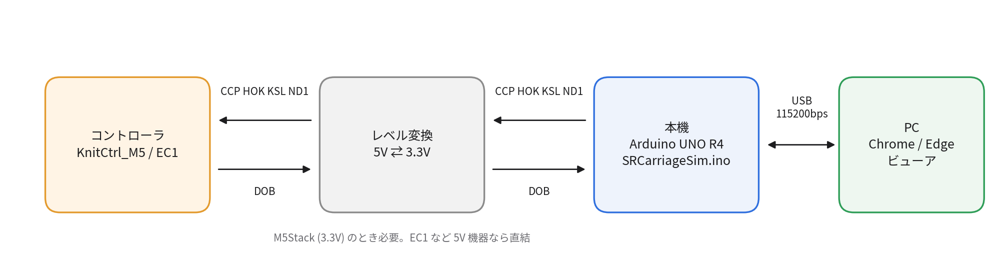
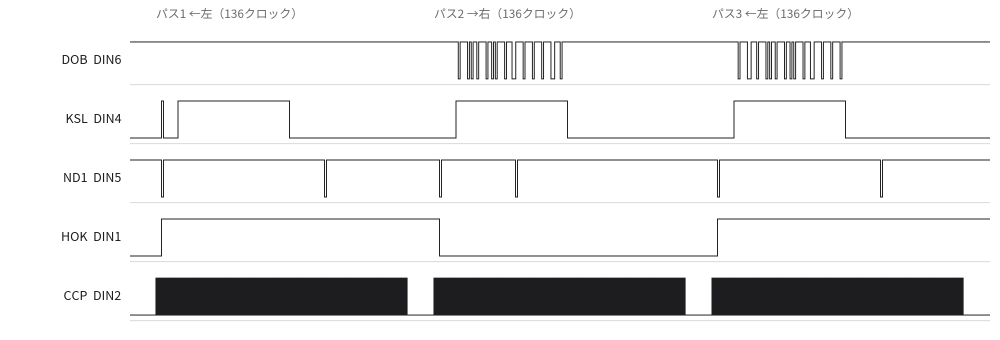
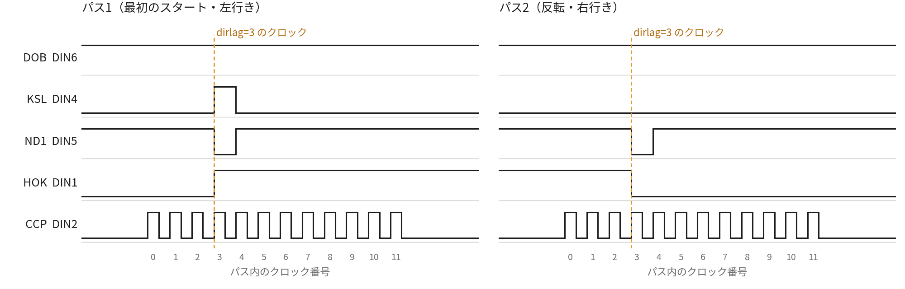
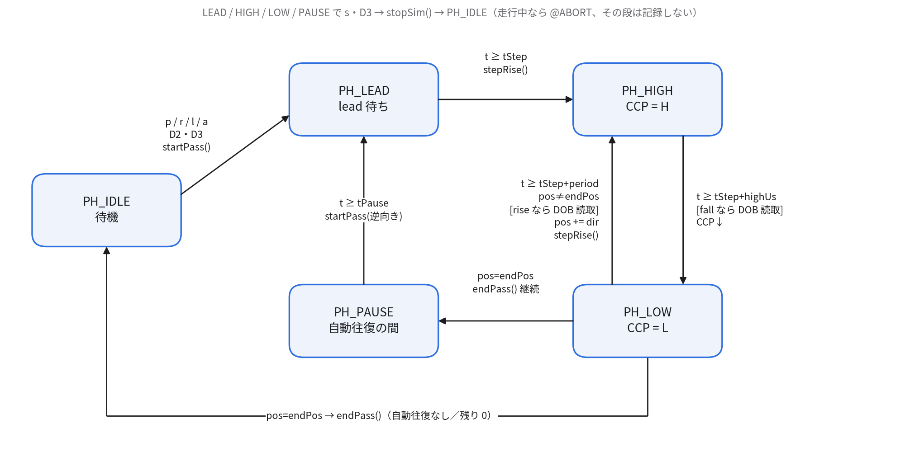
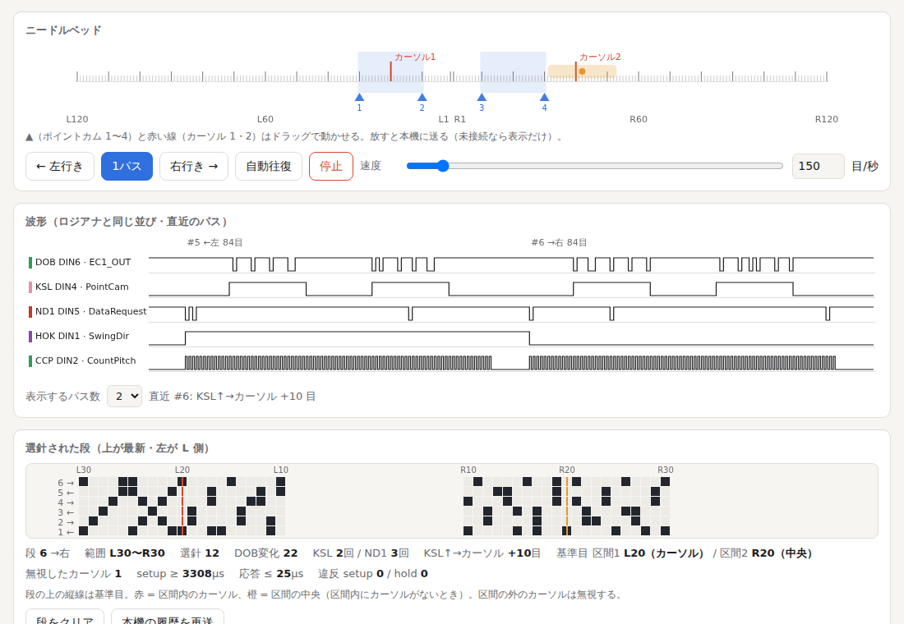
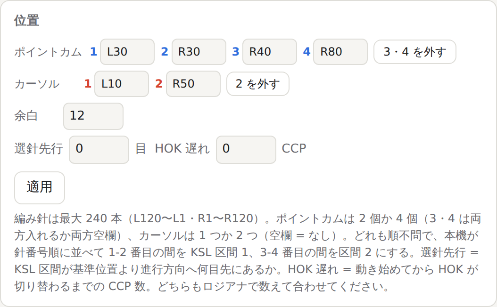
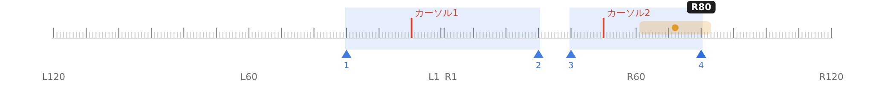

# SR キャリッジシミュレータ 詳細設計仕様書

SRCarriageSim.ino ／ SRCarriageSim_viewer.html

Silver Reed 電子キャリッジの信号を Arduino UNO R4 で再現し、編み機コントローラを検証する装置

| **項目**           | **内容**                                                          |
|--------------------|-------------------------------------------------------------------|
| 文書版             | 1017（第 3 版）                                                   |
| 対象ファームウェア | SRCarriageSim.ino　SIM_VERSION "1017"　設定識別子 SRC6            |
| 対象ビューア       | SRCarriageSim_viewer.html（1017）                                 |
| 対象ボード         | Arduino UNO R4 Minima ／ Arduino UNO R4 WiFi                      |
| 作成日             | 2026 年 9 月 24 日                                                |
| 改訂日             | 2026 年 10 月 17 日（第 3 版。信号名の変更と DIN ピン番号の訂正） |

## 1. 概要

### 1.1 目的

本装置は、Silver Reed 電子編み機のキャリッジが出す信号（ONP・OCD・OPC・ON1）を Arduino UNO R4 で生成し、編み機コントローラが返す選針データ（INS）を 1 目ずつ読み取って記録する。編み機を使わずに、KnitCtrl_M5 や EC1 などのコントローラの選針動作とタイミングを確かめることが目的である。

信号の意味と極性は、キャリッジ DIN コネクタの実機解析（2026 年 9 月）と、EC1 を接続したロジックアナライザの波形に基づく（2 章）。数値が確定していない項目はシリアルコマンドで変更でき、本体に保存できる。

### 1.2 構成

**表 1　成果物**

| **成果物**                | **役割**                                                                                                                                                           |
|---------------------------|--------------------------------------------------------------------------------------------------------------------------------------------------------------------|
| SRCarriageSim.ino         | UNO R4 用ファームウェア。キャリッジ信号の生成、INS の読み取り、選針結果と波形の記録、シリアルコマンド、ボタン、LED 表示、設定の保存                                |
| SRCarriageSim_viewer.html | PC 用ビューア（Chrome ／ Edge、Web Serial）。本機の操作、ニードルベッド・波形・選針結果の表示。外部ファイルに依存しない 1 ファイル。本機なしで動くデモモードを持つ |



図 1　システム構成

本機はキャリッジの代わりにコントローラと接続する。コントローラが M5Stack（3.3V）の場合はレベル変換を挟む。PC とは USB で接続し、ビューアまたはシリアルモニタから操作する。

### 1.3 用語

**表 2　用語**

| **用語**             | **意味**                                                                                                                                                                                                                                                                                                                                                                 |
|----------------------|--------------------------------------------------------------------------------------------------------------------------------------------------------------------------------------------------------------------------------------------------------------------------------------------------------------------------------------------------------------------------|
| パス                 | キャリッジの片道 1 回の走行                                                                                                                                                                                                                                                                                                                                              |
| クロック             | ONP の 1 周期（1 目ぶん）。パス内のクロック番号は 0 から数える                                                                                                                                                                                                                                                                                                           |
| 針番号               | 本機内部の針の番号 0〜239（編み針は最大 240 本）。L120 = 0 … L1 = 119、R1 = 120 … R120 = 239                                                                                                                                                                                                                                                                             |
| 基準位置（pos）      | キャリッジの位置。ONP を数える位置で、カーソル（ON1）の判定に使う                                                                                                                                                                                                                                                                                                        |
| 選針位置             | 基準位置 + 進行方向 × offset。OPC 区間の判定と選針結果の記録に使う                                                                                                                                                                                                                                                                                                       |
| ポイントカム         | OPC 区間の端を決める点（PointCam）。2 個か 4 個。cam で順不問に指定する                                                                                                                                                                                                                                                                                                  |
| OPC 区間             | パターン出力区間（ポイントカム有効区間）。ポイントカムを針番号順に並べ、1-2 番目の間が区間 1、3-4 番目の間が区間 2                                                                                                                                                                                                                                                       |
| カーソル             | パターン基準目（needle1）。1 つか 2 つ。基準位置がここを通るときに ON1 の L パルスを出す                                                                                                                                                                                                                                                                                 |
| 基準目               | OPC 区間ごとのパターンの基準。区間内でカーソルパルスが出たらその目、出なければ区間の中央（2.2 節）                                                                                                                                                                                                                                                                       |
| 編み出しパルス       | 起動後（または init 後）最初のパスで 1 回だけ出る OPC の H パルス                                                                                                                                                                                                                                                                                                        |
| スタート／反転パルス | 各パスで OCD を切り替えるクロックに出す ON1 の L パルス                                                                                                                                                                                                                                                                                                                  |
| 段（行）             | 1 パスで記録した選針結果                                                                                                                                                                                                                                                                                                                                                 |
| 選針／平編み         | INS = L（GND）が選針、INS = H（5V）が平編み                                                                                                                                                                                                                                                                                                                              |
| 信号名（1017）       | OCD = キャリッジ方向（Out Carriage Direction。旧 HOK）、ONP = 編み目カウント（Out Needle Pulse。旧 CCP）、OPC = パターン出力フラグ（Out Point Cam。ポイントカム有効区間。旧 KSL）、ON1 = カーソル（Out Needle 1。旧 ND1）、INS = 選針（In Needle Select。旧 DOB）。O はキャリッジ（本機）から出る信号、I はキャリッジへ入る信号。旧名は付録 B の 0923〜0925 の記述に残る |

### 1.4 参照

- キャリッジ DIN コネクタの実機解析結果（2026 年 9 月、付録 A。DIN のピン番号は 2026 年 10 月 17 日に訂正、2.1 節）

- EC1 接続時のロジックアナライザ波形（2026 年 9 月、2.3 節）

- romkal/silverduino（GitHub）— Arduino のピン番号の出典（信号名は 1017 で OCD・ONP・OPC・ON1・INS に改めた）。キャリッジ駆動部は未完成のため、動作の根拠にはしていない

## 2. キャリッジインタフェース仕様

### 2.1 DIN コネクタの信号（2026-10-17 訂正）

**表 3　キャリッジ DIN コネクタの信号**

| **DIN** | **信号** | **向き**                  | **意味**                                                                                                                                                                                                                                                 | **本機ピン** |
|---------|----------|---------------------------|----------------------------------------------------------------------------------------------------------------------------------------------------------------------------------------------------------------------------------------------------------|--------------|
| 2       | OCD      | キャリッジ → コントローラ | キャリッジ方向。H = 左←右（左行き）、L = 左→右（右行き）                                                                                                                                                                                                 | D5 出力      |
| 4       | ONP      | キャリッジ → コントローラ | 編み目カウント。立ち上がり（L→H）で 1 目進んだことを示すパルス                                                                                                                                                                                           | D6 出力      |
| 5       | OPC      | キャリッジ → コントローラ | パターン出力フラグ（ポイントカム有効区間）。H（5V）の間、選針にパターンを出力する。1 回のキャリッジ移動で出力区間は最大 2 か所（ポイントカム 4 個）。最初の編み出し時にパルスが出る                                                                      | D8 出力      |
| 1       | ON1      | キャリッジ → コントローラ | カーソル（パターン基準目。パターンのスタート位置）。パターンは基準目を中心に前後へ、OPC が H の間出力する。カーソル通過で L パルス。キャリッジのスタート時と反転時にも L パルス。カーソルは 2 つまで置け、2 つなら 1 回の走行でカーソルパルスが 2 回出る | D9 出力      |
| 3       | INS      | コントローラ → キャリッジ | 選針データ。選針 = GND（L）、平編み = 5V（H）                                                                                                                                                                                                            | D7 入力      |

DIN のピン番号は 2026 年 10 月 17 日に実機に合わせて訂正した（当初の記録は OCD 1・ONP 2・OPC 4・ON1 5・INS 6 で誤り）。電源・GND を含むコネクタとケーブルの対応を表 3b に示す。本機と相手機器の GND は必ず共通にする。

**表 3b　コネクタとケーブル（XH 8 ピン ⇔ DIN 7 ピン メス、2026-10-17）**

| **XH** | **名称** | **ケーブル色** | **内容**                                          | **DIN（7 ピン メス）** |
|--------|----------|----------------|---------------------------------------------------|------------------------|
| 1      | Vcc(5V)  | 白             | 電源 5V                                           | 7                      |
| 2      | GND      | 緑             | GND。本機と相手機器の GND は共通にする            | キー                   |
| 3      | 16V      | 黄             | 16V。本機のピンにはつながない（UNO R4 は 5V）     | 6                      |
| 4      | ONP      | 青             | 編み目カウント。L→H の立ち上がりパルス（本機 D6） | 4                      |
| 5      | OPC      | 黒             | H = ポイントカム有効区間（本機 D8）               | 5                      |
| 6      | ON1      | 赤             | カーソル。ネガティブインパルス（本機 D9）         | 1                      |
| 7      | OCD      | 灰             | キャリッジ方向。H = 左←右、L = 左→右（本機 D5）   | 2                      |
| 8      | INS      | オレンジ       | 選針。H = 平編み、L = 編み込み（本機 D7）         | 3                      |

### 2.2 カーソルとポイントカム（実機確定）

- カーソルは 2 つまで置ける（カーソル 1・2）。2 つあると、1 回の走行で ON1 のカーソルパルスが 2 回出る（needle1-1 ／ needle1-2）

- カーソルが 2 つのとき、OPC のポイントカムは 4 個（PointCam1〜4）になることがある。このとき OPC の H 区間は 2 か所

- ポイントカム 1〜4 とカーソル 1・2 は、順番に関係なく自由な針位置に置ける

基準目は次の規則で決める（実機の規則として受けた内容）。本機はこの規則で区間ごとの基準目を計算し、段ごとに @ROW の ref1・ref2 として出す（信号そのものには影響しない）。コントローラの実装と照らし合わせるための値である。

1.  OPC 区間の中（2 つのポイントカムの間）でカーソルパルスが出たら、その目を基準目とする

2.  OPC 区間の中でカーソルパルスが出なければ、区間の中央（2 つのポイントカムの中央）を基準目とする

3.  OPC 区間の外（区間 1 と区間 2 の間など）で出たカーソルパルスは無視する

4.  1 つの区間でカーソルパルスが 2 回出た場合は、走行順で先のものを使う（この扱いは未確認）

「その目」は、カーソルパルスが出たクロックで選針している針（選針位置）である。offset が 0 なら カーソルの針と同じ、offset があるとその分だけ進行方向へずれる。

**表 4　基準目の例（本機の出力。ホスト試験 cursors シナリオ）**

| **ポイントカム**             | **カーソル**               | **区間 1 の基準目**                    | **区間 2 の基準目** | **無視** |
|------------------------------|----------------------------|----------------------------------------|---------------------|----------|
| L30・L10・R10・R30（順不問） | L20・R20                   | L20（カーソル）                        | R20（カーソル）     | 0        |
| 同上                         | L20・R1（R1 は区間の間）   | L20（カーソル）                        | R20（中央）         | 1        |
| 同上                         | L40・R40（どちらも区間外） | L20（中央）                            | R20（中央）         | 2        |
| L30・R30                     | L10・R10（1 区間に 2 つ）  | 右行き L10 ／ 左行き R10（走行順で先） | —                   | 1        |
| L1・R1                       | R50（区間外）              | L1〜R1 の間（中央、半目）              | —                   | 1        |

### 2.3 ロジックアナライザ波形から読み取った動作

EC1 を接続した実機の波形（チャンネル名 EC1_OUT_Carriage ＝ INS、EC1_PointCam ＝ OPC、EC1_DataRequest ＝ ON1、EC1_SwingDir ＝ OCD、EC1_CountPitch ＝ ONP）から、次の動作を読み取った。

1.  スタート時、OCD の切り替えと同時に ON1 の L パルスと OPC のパルス（編み出しパルス）が出る。

2.  反転時は OCD の切り替えと同時に ON1 の L パルスが出る。OPC のパルスは出ない。

3.  OCD が切り替わる前に、新しい向きの ONP が数発出ている。

4.  ON1 のカーソルパルスは、左行きでは OPC 区間の後、右行きでは OPC 区間の途中に来る。OPC 区間がカーソルに対して進行方向の先へずれていると考えると、両方向の観察と合う。

5.  EC1 は OPC が L の間、INS を H（平編み）に保つ。柄は OPC が H の間だけ出る。

6.  1 パス目（左行き）でも、カーソル通過の前に INS に柄が出ている。

### 2.4 本機でのモデル化

**表 5　観察された動作と本機の表現**

| **観察**                           | **本機での表現**                                                                                               | **パラメータ** |
|------------------------------------|----------------------------------------------------------------------------------------------------------------|----------------|
| OCD 切り替え前の ONP               | パスの dirlag 番目のクロックで OCD を切り替える。それより前のクロックは新しい向きに進むが OCD は前の向きのまま | dirlag 0〜20   |
| スタート／反転の ON1 L パルス      | OCD を切り替えるクロックで ON1 を 1 クロックぶん L にする                                                      | on1edge 0/1    |
| 編み出しの OPC パルス              | 起動後・init 後の最初のパスで、OCD を切り替えるクロックに OPC を 1 クロックぶん H にする                       | opcimp 0/1     |
| OPC 区間の進行方向へのずれ         | 選針位置（基準位置 + 進行方向 × offset）が OPC 区間内のとき OPC = H。選針結果も選針位置に記録する              | offset −60〜60 |
| ポイントカム 2 個か 4 個（順不問） | cam A B \[C D\] を針番号順に並べ、1-2 番目の間を OPC 区間 1、3-4 番目の間を区間 2 にする                       | cam ／ cam2    |
| カーソル 1 つか 2 つ（順不問）     | 基準位置がカーソル 1 または 2 の針に来たクロックで ON1 を 1 クロックぶん L にする                              | on1 A \[B\]    |
| 基準目の規則                       | 区間ごとに計算して @ROW の ref1 ／ ref2 と無視した数 ign に出す（2.2 節、5.15 節）                             | —              |
| 折り返し                           | 端の針は往路の最後と復路の最初の両方でクロックを出す（モデル上の仮定）                                         | —              |



図 2　本機の出力波形（offset 26、カーソル L24、dirlag 3。ビューアと同じチャンネル順）

図 2 は本機のファームウェアを PC 上で動かして得た @WAVE 出力をそのまま描いたものである。左行きのパス 1・3 ではカーソルパルスが OPC 区間の後に、右行きのパス 2 では区間の途中に来る。パス 1 の INS に柄がないのは、試験用コントローラがカーソルを通るまで位置を知らないためである（9 章）。



図 3　パスの始まり（左: 最初のスタート、右: 反転）。3 番目のクロックで OCD が切り替わる

### 2.5 未確定事項と校正

**表 6　数値が未確定の項目**

| **項目**                                    | **現在の既定**       | **決め方**                                             |
|---------------------------------------------|----------------------|--------------------------------------------------------|
| 選針先行 offset                             | 0                    | 下の式で求める                                         |
| カーソル位置 on1                            | R1                   | 下の式で求める                                         |
| OCD の遅れ dirlag                           | 0                    | 動き始めてから OCD が切り替わるまでの ONP の数を数える |
| INS を読む時点 sample                       | fall（ONP↓）         | キャリッジ側のラッチ時点。実機の仕様が分かれば合わせる |
| ON1 ／ OPC パルスの幅                       | 1 クロック           | ロジアナで確認                                         |
| 1 つの区間にカーソルが 2 つあるときの基準目 | 走行順で先のカーソル | 実機（EC1）で確認                                      |
| 折り返しのクロック                          | 端の針を 2 回数える  | 反転前後の ONP を数えて確認                            |

#### 校正手順（offset とカーソル位置）

ロジアナで次の 3 つを数える。

- W：OPC が H の間の ONP の数（= OPC 区間の目数）

- a：左行きで、OPC の立ち上がりからカーソルパルスまでの ONP の数

- b：右行きで、OPC の立ち上がりからカーソルパルスまでの ONP の数

このとき

```text
offset = (a + b − W + 1) ÷ 2
カーソルの針 = OPC 区間の右端の針番号 + offset − a
```

本機は段ごとに「OPC↑→カーソル」のクロック数（k2c）を出すので、校正後に a・b と一致することを確かめられる。例として既定値（区間 L30〜R30、W = 60、カーソル R1、offset 0）では a = 29、b = 30 となり、式から offset = 0、カーソル = 149 + 0 − 29 = 120（R1）が得られる。図 2 の設定（offset 26、カーソル L24）では a = 79、b = 32 で、offset = (79 + 32 − 60 + 1) ÷ 2 = 26、カーソル = 149 + 26 − 79 = 96（L24）となる。

## 3. ハードウェア

### 3.1 対象ボード

Arduino UNO R4 Minima または UNO R4 WiFi（Renesas RA4M1、48 MHz、5V ロジック）。UNO R4 WiFi では内蔵の 12 × 8 LED マトリクスに直近 8 段を表示する。ボードの判別はコンパイル時のマクロ ARDUINO_UNOWIFIR4 による。

### 3.2 ピン割り当て

**表 7　ピン割り当て**

| **ピン** | **名前（定数）**           | **モード**   | **用途**                                   |
|----------|----------------------------|--------------|--------------------------------------------|
| D5       | PIN_OCD                    | OUTPUT       | OCD（DIN 2・XH 7）                         |
| D6       | PIN_ONP                    | OUTPUT       | ONP（DIN 4・XH 4）                         |
| D7       | PIN_INS                    | INPUT_PULLUP | INS（DIN 3・XH 8）。未接続時は H（平編み） |
| D8       | PIN_OPC                    | OUTPUT       | OPC（DIN 5・XH 5）                         |
| D9       | PIN_ON1                    | OUTPUT       | ON1（DIN 1・XH 6）                         |
| D2       | PIN_BTN_PASS               | INPUT_PULLUP | ボタン（GND へ）: 1 パス                   |
| D3       | PIN_BTN_AUTO               | INPUT_PULLUP | ボタン（GND へ）: 自動往復の開始・停止     |
| D13      | PIN_OPC_LED（LED_BUILTIN） | OUTPUT       | OPC がパターン出力中のとき点灯             |
| —        | LED マトリクス             | （内蔵）     | UNO R4 WiFi のみ。直近 8 段の表示          |

ピン番号（D5〜D9）は silverduino に合わせた。信号名は 1017 で OCD・ONP・OPC・ON1・INS に改めた（旧 HOK・CCP・KSL・ND1・DOB。表 2）。PIN_LED はボード定義で使われているマクロ名なので、D13 には PIN_OPC_LED という名前を使う。

### 3.3 電気的条件

- キャリッジの信号は 5V。UNO R4 も 5V ロジックなので、EC1 など 5V の機器とは直接つなげる。

- M5Stack（ESP32、3.3V）とつなぐときはレベル変換を入れる。本機からの 4 本（ONP・OCD・OPC・ON1）は 5V→3.3V、INS は 3.3V→5V。3.3V の出力を直接つなぐと、INS の H が H と判定されないおそれがある。

- INS は内部プルアップの入力なので、コントローラが未接続のときは平編み（選針なし）として記録される。

- 電源は USB から供給する。

コネクタの 16V（DIN 6・XH 3）は本機のピンにつながない（表 3b）。

## 4. ソフトウェア構成

### 4.1 開発環境

**表 8　開発環境**

| **項目**         | **内容**                                                              |
|------------------|-----------------------------------------------------------------------|
| IDE              | Arduino IDE 2.x、または arduino-cli                                   |
| ボードパッケージ | Arduino UNO R4 Boards（arduino:renesas_uno）                          |
| FQBN             | arduino:renesas_uno:minima ／ arduino:renesas_uno:unor4wifi           |
| ライブラリ       | EEPROM（コア同梱）、Arduino_LED_Matrix（コア同梱、WiFi のみ）         |
| スケッチフォルダ | SRCarriageSim/SRCarriageSim.ino（フォルダ名とファイル名を一致させる） |

Arduino IDE はスケッチの関数プロトタイプを自動生成して最初の関数の前に挿入する。構造体や列挙型を関数より後に置くとプロトタイプで型が未定義になるため、型はすべてソースの先頭（最初の関数より前）に定義している。

### 4.2 ソースの構成

**表 9　SRCarriageSim.ino の構成（上から順）**

| **区分**                 | **主な内容**                                                                                            |
|--------------------------|---------------------------------------------------------------------------------------------------------|
| ヘッダコメント           | 信号表、ロジアナ観察、未確定事項、1 パスの動き、電圧、針番号                                            |
| インクルード・ボード判定 | Arduino.h、EEPROM.h、標準 C ライブラリ。ARDUINO_UNOWIFIR4 なら LED マトリクスを有効化（SIM_HAS_MATRIX） |
| 定数                     | ピン番号、NEEDLES・HALF・ROW_BYTES・HIST_ROWS・CFG_MAGIC・WAVE_MAX・速度範囲                            |
| 型                       | SimConfig・SimPhase・PassStat・RowRec・NO_K2C・Button                                                   |
| 状態                     | 設定、走行状態、統計、波形、履歴、シリアル行バッファ、出力バッファ                                      |
| 小物                     | 時刻比較、ビット操作、区間判定、選針位置、針番号の変換、数値の解析                                      |
| 設定                     | 既定値、妥当性検査、タイミング計算、EEPROM の読み書き                                                   |
| 出力ピン                 | ONP・OCD・ON1・OPC の出力（極性の適用、パルス数の計数）、INS の入力                                     |
| 表示                     | 設定・段の出力、LED マトリクス                                                                          |
| INS 監視                 | INS の変化検出、読み取りと記録                                                                          |
| 走行                     | パス開始、1 クロックの処理、波形出力、パス終了、停止、状態機械、自動往復                                |
| コマンド                 | ヘルプ、コマンド解釈、シリアル受信、ボタン                                                              |
| Arduino                  | setup()・loop()                                                                                         |

### 4.3 定数

**表 10　定数**

| **名前**           | **値**                  | **意味**                                                                            |
|--------------------|-------------------------|-------------------------------------------------------------------------------------|
| SIM_VERSION        | "1017"                  | ファームウェアの版。@CFG の ver とヘルプに出す                                      |
| NEEDLES            | 240                     | 編み針の最大数（L120〜R120）                                                        |
| HALF               | 120                     | 片側の本数。L1 = HALF − 1、R1 = HALF                                                |
| ROW_BYTES          | 30                      | 1 段の選針ビット列のバイト数（240 ÷ 8）                                             |
| HIST_ROWS          | 64                      | 履歴に残す段数                                                                      |
| CFG_MAGIC          | 0x53524336（"SRC6"）    | EEPROM の設定の識別子。SimConfig の配置や針番号の意味を変えたら値を変える           |
| WAVE_MAX           | 480（NEEDLES + 4 × 60） | 1 パスで波形を記録する最大クロック数。全針・余白 60・offset 60 の最大の走行が収まる |
| SPS_MIN ／ SPS_MAX | 1 ／ 2000               | 速度の範囲 \[目/秒\]                                                                |
| NO_K2C             | 9999                    | 「OPC↑→カーソル」が求まらなかったことを示す値                                       |
| NO_REF             | −1                      | 基準目なし（区間がない）を示す値                                                    |
| CUR_MAX            | 4                       | 1 パスで記録するカーソルパルスの最大数                                              |

### 4.4 データ構造

#### SimConfig（設定。EEPROM に保存する）

**表 11　SimConfig のフィールド**

| **フィールド** | **型** | **既定値**              | **範囲**                                | **コマンド** | **意味**                                                |
|----------------|--------|-------------------------|-----------------------------------------|--------------|---------------------------------------------------------|
| magic          | u32    | 0x53524336              | —                                       | —            | 設定の識別子                                            |
| sps            | u16    | 150                     | 1〜2000                                 | speed        | 走行速度 \[目/秒\]                                      |
| camL ／ camR   | i16    | 90 ／ 149（L30 ／ R30） | 0〜239、L \< R                          | cam          | ポイントカム 1・2（OPC 区間 1）。針番号順に並べ替え済み |
| cam2L ／ cam2R | i16    | −1 ／ −1                | −1（なし）または 0〜239、camR \< L \< R | cam ／ cam2  | ポイントカム 3・4（OPC 区間 2）                         |
| on1            | i16    | 120（R1）               | 0〜239                                  | on1          | カーソル 1（パターン基準目）                            |
| on1b           | i16    | −1                      | −1（なし）または 0〜239                 | on1          | カーソル 2                                              |
| margin         | i16    | 12                      | 1〜60                                   | margin       | OPC 区間の外側へ走る目数                                |
| offset         | i16    | 0                       | −60〜60                                 | offset       | 選針位置の先行 \[目\]                                   |
| matL           | i16    | −1                      | −1 または 0〜239                        | mat          | LED マトリクスの左端の針（−1 = 区間の左端）             |
| pauseMs        | u16    | 400                     | 0〜60000                                | pause        | 自動往復のパス間の待ち \[ms\]                           |
| leadUs         | u16    | 2000                    | 0〜60000                                | lead         | パス開始（@PASS 出力）から最初の ONP↑ まで \[µs\]       |
| warnSetupUs    | u16    | 50                      | 0〜60000                                | warn         | setup 警告のしきい値 \[µs\]                             |
| warnHoldUs     | u16    | 10                      | 0〜60000                                | warn         | hold 警告のしきい値 \[µs\]                              |
| duty           | u8     | 50                      | 5〜95                                   | duty         | ONP の H の比率 \[%\]                                   |
| sampleRise     | u8     | 0                       | 0 ／ 1                                  | sample       | 0 = ONP↓で読む、1 = 次の ONP↑ の直前で読む              |
| on1Edge        | u8     | 1                       | 0 ／ 1                                  | on1edge      | スタート／反転時の ON1 L パルス                         |
| opcImp         | u8     | 1                       | 0 ／ 1                                  | opcimp       | 編み出しの OPC パルス                                   |
| dirLag         | u8     | 0                       | 0〜20                                   | dirlag       | OCD を切り替えるクロック番号                            |
| ocdRight       | u8     | 0（L）                  | 0 ／ 1                                  | pol ocd      | 右行きのときの OCD レベル（実機 L）                     |
| on1Act         | u8     | 0（L）                  | 0 ／ 1                                  | pol on1      | ON1 の有効レベル（実機 L）                              |
| opcIn          | u8     | 1（H）                  | 0 ／ 1                                  | pol opc      | パターン出力中の OPC レベル（実機 H）                   |
| insSel         | u8     | 0（L）                  | 0 ／ 1                                  | pol ins      | 選針を表す INS レベル（実機 L = GND）                   |

#### SimPhase（状態）

**表 12　SimPhase**

| **値**   | **意味**                                     |
|----------|----------------------------------------------|
| PH_IDLE  | 待機。コマンドとボタンを受け付ける           |
| PH_PAUSE | 自動往復のパス間の待ち。コマンドは受け付ける |
| PH_LEAD  | パス開始から最初の ONP↑ までの待ち           |
| PH_HIGH  | ONP が H の区間                              |
| PH_LOW   | ONP が L の区間                              |

#### PassStat（パスの統計）

**表 13　PassStat のフィールド**

| **フィールド**         | **型** | **意味**                                                                          |
|------------------------|--------|-----------------------------------------------------------------------------------|
| samples                | u16    | OPC 区間内で INS を読んだ回数                                                     |
| sel                    | u16    | 選針された針の数                                                                  |
| changes                | u16    | 走行中（PH_HIGH ／ PH_LOW）の INS の変化回数                                      |
| setupViol ／ holdViol  | u16    | setup 違反 ／ hold 違反の回数                                                     |
| opcPulses ／ on1Pulses | u8     | OPC がパターン出力になった回数 ／ ON1 が有効になった回数（パルス込み、最大 255）  |
| k2c                    | i16    | OPC 区間に入ったクロックからカーソルのクロックまでの数。どちらかがなければ NO_K2C |
| ref2x\[2\]             | i16    | 区間 1・2 の基準目の針番号 × 2（半目を表すため 2 倍）。区間がなければ NO_REF      |
| refSrc\[2\]            | char   | 'c' = 区間内のカーソル、'm' = 区間の中央、'-' = 区間なし                          |
| ign                    | u8     | 基準目に使わなかったカーソルパルスの数（区間外、同じ区間の 2 回目以降）           |
| minSetup               | u32    | INS の変化から読み取りまでの最小時間 \[µs\]                                       |
| maxLat                 | u32    | ONP↑ から INS の変化までの最大時間 \[µs\]                                         |

#### RowRec（履歴の 1 段）ほか

**表 14　RowRec と Button**

| **型** | **フィールド**                   | **意味**                                                                 |
|--------|----------------------------------|--------------------------------------------------------------------------|
| RowRec | no                               | 段番号（パス番号）                                                       |
|        | dir                              | +1 = 右行き、−1 = 左行き                                                 |
|        | l1 ／ r1 ／ l2 ／ r2             | その段の OPC 区間（l2 = −1 なら 1 区間）                                 |
|        | st                               | その段の PassStat                                                        |
|        | bits\[30\]                       | 選針ビット列。針 i がバイト i ÷ 8 のビット i mod 8（LSB から）。1 = 選針 |
| Button | pin ／ stable ／ last ／ tChange | ピン、確定状態、直前の読み値、変化時刻 \[ms\]                            |

### 4.5 主な状態変数

**表 15　主な状態変数**

| **変数**                                  | **意味**                                                                                     |
|-------------------------------------------|----------------------------------------------------------------------------------------------|
| ph                                        | 現在の状態（SimPhase）                                                                       |
| pos ／ startPos ／ endPos                 | 基準位置、パスの開始位置、終了位置（針番号。盤外は負や 240 以上）                            |
| dir ／ side                               | 進行方向（+1 右 ／ −1 左）、キャリッジのいる端（+1 右端 ／ −1 左端。起動時は右端）           |
| tStep ／ tPause                           | 現在のクロックの ONP↑ 予定時刻、自動往復の再開時刻 \[µs\]                                    |
| periodUs ／ highUs                        | ONP の周期と H の時間 \[µs\]                                                                 |
| autoOn ／ autoInf ／ autoLeft             | 自動往復中、無制限、残りパス数                                                               |
| passNo                                    | パス（段）番号                                                                               |
| opcImpPending ／ opcImpThis               | 次のパスで編み出しパルスを出すか、今のパスで出すか                                           |
| opcOut ／ on1Out ／ ocdLevel              | OPC・ON1 の論理状態（true = 出力中 ／ 有効）、OCD のピンレベル                               |
| stepIdx ／ opcFirst ／ curIdx             | パス内のクロック番号、OPC 区間に入ったクロック、最初のカーソルのクロック                     |
| curN ／ curSel\[4\] ／ curWin\[4\]        | このパスのカーソルパルスの数、そのときの選針位置、そのとき OPC が H だった区間（0 = 区間外） |
| wave\[480\]                               | 1 クロックごとのピンレベル（b0 OPC、b1 ON1、b2 INS、b3 OCD）                                 |
| cur\[30\] ／ st                           | 記録中の段の選針ビット列と統計                                                               |
| insLast ／ tInsChange ／ tRise ／ tSample | INS の最新値、INS の変化時刻、直前の ONP↑ 時刻、直前の読み取り時刻                           |
| hist\[64\] ／ histHead ／ histCount       | 履歴（リングバッファ）                                                                       |
| line\[96\] ／ obuf\[640\]                 | シリアルの受信行、送信行の組み立て用                                                         |

### 4.6 メモリ使用量

**表 16　ビルド結果（arm-none-eabi-gcc 13.3.1 でコンパイル）**

| **ボード**    | **プログラム領域**   | **RAM（グローバル変数）** |
|---------------|----------------------|---------------------------|
| UNO R4 WiFi   | 70,156 バイト（26%） | 13,924 バイト（42%）      |
| UNO R4 Minima | 63,796 バイト（24%） | 10,988 バイト（33%）      |

Arduino IDE 標準のコンパイラ（gcc 7-2017q4）では数値が少し変わる。

### 4.7 関数一覧

**表 17　関数**

| **関数**                     | **区分** | **役割**                                                                                             |
|------------------------------|----------|------------------------------------------------------------------------------------------------------|
| due(now, t)                  | 小物     | 時刻 t に達したか。(int32_t)(now − t) \>= 0 で比べるので micros() の桁あふれ（約 71.6 分）でも正しい |
| setBit ／ getBit             | 小物     | 選針ビット列の操作                                                                                   |
| inWin(l1, r1, l2, r2, p)     | 小物     | p が 2 つの区間のどちらかに入るか                                                                    |
| inside(p)                    | 小物     | p が現在の設定の OPC 区間に入るか                                                                    |
| selPos()                     | 小物     | 選針位置 = pos + dir × offset                                                                        |
| winOf(p)                     | 小物     | p が入る OPC 区間（0 = なし、1、2）                                                                  |
| spanL ／ spanR               | 小物     | 2 区間を合わせた左端 ／ 右端                                                                         |
| say(s)                       | 小物     | 1 行をシリアルに出す                                                                                 |
| needleName ／ parseNeedle    | 小物     | 針番号と "L30"・"R30" 表記の変換。数値（0〜239）も受け付ける                                         |
| parseLong(s, lo, hi, out)    | 小物     | 整数の解析と範囲検査                                                                                 |
| setDefaults()                | 設定     | 既定値を入れる                                                                                       |
| cfgValid(c)                  | 設定     | EEPROM から読んだ設定の妥当性検査（識別子と全フィールドの範囲）                                      |
| applyTiming()                | 設定     | periodUs と highUs を計算する                                                                        |
| loadConfig() ／ saveConfig() | 設定     | EEPROM アドレス 0 から読む ／ 書く                                                                   |
| pinLevel ／ outOnp           | 出力     | ピンへの出力                                                                                         |
| outOcd(d)                    | 出力     | 方向 d のレベルを OCD に出す（極性を適用し、ocdLevel に保持）                                        |
| outOn1(on) ／ outOpc(on)     | 出力     | 論理状態を極性に合わせて出す。有効になった回数を数える。OPC は D13 にも出す                          |
| readIns()                    | 入力     | INS が H か                                                                                          |
| outRest()                    | 出力     | ONP = L、OPC・ON1 を無効にする（OCD は変えない）                                                     |
| printCfg()                   | 表示     | @CFG と設定 2 行を出す                                                                               |
| refName ／ refCode           | 表示     | 基準目（× 2）を "R1"・"L1〜R1の間" ／ "c120"・"m119.5" に変換                                        |
| printRow(r)                  | 表示     | 段の人向け 3〜4 行と @ROW を出す                                                                     |
| updateMatrix()               | 表示     | LED マトリクスに直近 8 段を出す（WiFi 以外は空の関数）                                               |
| pollIns(now)                 | INS      | INS の変化を検出し、変化回数・応答時間・hold 違反を記録する                                          |
| sampleNeedle(now)            | INS      | INS を読み、波形に記録する。選針位置が OPC 区間内なら setup を測り、選針結果を記録する               |
| startPass(d)                 | 走行     | パスを始める（5.5 節）                                                                               |
| stepRise(now)                | 走行     | 1 クロックの立ち上がり処理（5.3 節）                                                                 |
| printWave()                  | 走行     | @WAVE を出す                                                                                         |
| endPass()                    | 走行     | パスを終える。基準目もここで計算する（5.7 節、5.15 節）                                              |
| stopSim()                    | 走行     | 停止する（5.8 節）                                                                                   |
| runSim(now)                  | 走行     | 状態機械（5.2 節）                                                                                   |
| startAuto(n)                 | 走行     | 自動往復を始める（n = 0 は無制限）                                                                   |
| printHelp()                  | コマンド | コマンド一覧を出す                                                                                   |
| busy()                       | コマンド | PH_LEAD ／ PH_HIGH ／ PH_LOW のとき true                                                             |
| handleCommand(s)             | コマンド | 1 行のコマンドを解釈して実行する（6 章）                                                             |
| pollSerial()                 | コマンド | 受信文字を行にまとめ、CR か LF で handleCommand を呼ぶ                                               |
| pressed(b, ms)               | コマンド | 30 ms のチャタリング除去。押した瞬間だけ true                                                        |
| pollButtons()                | コマンド | D2・D3 の処理（5.11 節）                                                                             |
| setup() ／ loop()            | Arduino  | 起動処理（5.13 節）／ メインループ（5.1 節）                                                         |

## 5. 動作仕様

### 5.1 メインループ

loop() は毎回 micros() を読み、pollIns → runSim → pollSerial → pollButtons の順に呼ぶ。delay() は使わず、すべての処理は予定時刻との比較で進む。タイミングの分解能はループ 1 周の時間（数 µs）で決まる。

### 5.2 状態遷移



図 4　状態遷移

**表 18　状態遷移**

| **現在の状態**               | **条件**                           | **処理**                                                            | **次の状態**                           |
|------------------------------|------------------------------------|---------------------------------------------------------------------|----------------------------------------|
| PH_IDLE                      | p ／ r ／ l ／ a ／ D2 ／ D3       | startPass()                                                         | PH_LEAD                                |
| PH_LEAD                      | t ≥ tStep                          | stepRise()                                                          | PH_HIGH                                |
| PH_HIGH                      | t ≥ tStep + highUs                 | sample fall なら sampleNeedle()、ONP↓                               | PH_LOW                                 |
| PH_LOW                       | t ≥ tStep + periodUs、pos ≠ endPos | sample rise なら sampleNeedle()、pos += dir、tStep 更新、stepRise() | PH_HIGH                                |
| PH_LOW                       | t ≥ tStep + periodUs、pos = endPos | sample rise なら sampleNeedle()、endPass()                          | PH_PAUSE（自動往復を続ける）／ PH_IDLE |
| PH_PAUSE                     | t ≥ tPause                         | startPass(−side)                                                    | PH_LEAD                                |
| LEAD ／ HIGH ／ LOW ／ PAUSE | s ／ D3（自動往復中）              | stopSim()                                                           | PH_IDLE                                |

### 5.3 1 クロックの処理（stepRise）

ONP を立ち上げる前に、同じ処理の中で OCD・OPC・ON1 を確定させる。コントローラは ONP↑ の時点でほかの信号が確定していると見なしてよい。

1.  k = stepIdx++（パス内のクロック番号）

2.  k == dirLag なら outOcd(dir)（OCD を切り替えるクロック = edge）

3.  win = inside(selPos())、cursor = (pos == on1) \|\| (on1b ≥ 0 && pos == on1b)

4.  最初に win になったクロックを opcFirst、最初に cursor になったクロックを curIdx に記録する。cursor のときは、選針位置とそのときの区間（winOf）を curSel・curWin に記録する（最大 4 回）

5.  outOpc(win \|\| (edge && opcImpThis))（編み出しパルスは edge の 1 クロック）

6.  outOn1(cursor \|\| (edge && on1Edge))（スタート／反転パルスは edge の 1 クロック）

7.  outOnp(true)（ONP↑）

8.  wave\[k\] に OPC・ON1・OCD のピンレベルを記録する（INS は読み取り時に追記）

9.  tRise = now、状態を PH_HIGH にする

OPC と ON1 は次のクロックの処理で改めて決まるので、パルスの幅は 1 クロック（ONP↑ から次の ONP↑ の直前まで）になる。

### 5.4 ONP のタイミング

```text
periodUs = 1000000 ÷ sps（整数）
highUs = periodUs × duty ÷ 100（1 以上、periodUs − 1 以下に制限）
ONP↑ : tStep ONP↓ : tStep + highUs 次の ONP↑ : tStep + periodUs
```

次のクロックの予定時刻は tStep += periodUs で積み上げるので、周期の誤差はたまらない。ループが 1 周期以上遅れた場合は、遅れを詰め込まずに tStep = now から数え直す。既定の 150 目/秒では周期 6,666 µs、H の時間 3,333 µs になる。

### 5.5 パスの開始（startPass）

1.  キャリッジのいる端と同じ向きに走らせるときは注意を出す（キャリッジを持ち上げて反対側へ移した扱い。針位置の連続性はない）

2.  走行範囲を決める（下の式）

3.  選針ビット列・統計・波形・stepIdx・opcFirst・curIdx を初期化する

4.  opcImpThis = opcImp && opcImpPending、opcImpPending = false

5.  passNo++、applyTiming()、outRest()（OCD はまだ変えない）

6.  @PASS を出し、そのあと tStep = micros() + leadUs として PH_LEAD へ

```text
L = 2 区間を合わせた左端、R = 同じく右端、o = |offset|
右行き: pos = L − margin − o … endPos = R + margin + o
左行き: pos = R + margin + o … endPos = L − margin − o
クロック数 = (R − L) + 2 × (margin + o) + 1
```

既定値では (149 − 90) + 2 × 12 + 1 = 84 クロック、offset 26 では 136 クロックになる。最大は全針・余白 60・offset 60 の 239 + 2 × 120 + 1 = 480 クロック（WAVE_MAX）。選針位置が区間の外まで抜けきるように、\|offset\| のぶん走行範囲を広げている。

### 5.6 INS の読み取りと記録

読み取る時点は sample で選ぶ。fall（既定）は ONP↓ の時点、rise は次の ONP↑ の直前（パスの最後のクロックでは周期の終わり）で読む。どちらもそのクロックの針として記録する。

#### sampleNeedle

1.  pollIns(now) で直前の変化を拾う

2.  INS が H なら wave\[k\] の b2 を立てる（OPC 区間外も記録する）

3.  選針位置 n = selPos() が OPC 区間外なら終わる

4.  setup = now − tInsChange。minSetup を更新し、warnSetupUs 未満なら setup 違反を数える

5.  samples++、tSample = now

6.  INS のレベルが insSel（既定 L）なら、針 n のビットを立てて sel++

#### pollIns

毎ループ INS を読み、変化したら tInsChange を更新する。走行中（PH_HIGH ／ PH_LOW）の変化については、変化回数を数え、ONP↑ からの時間を応答時間として最大値を残し、直前の読み取りから warnHoldUs 未満なら hold 違反を数える（そのパスで 1 回以上読んだ後のみ）。時間の分解能はループ 1 周ぶんである。

### 5.7 パスの終了（endPass）

1.  outRest()、side = dir

2.  基準目を計算する（5.15 節）。履歴に段を記録する（OPC 区間、統計、k2c = curIdx − opcFirst、基準目、選針ビット列）

3.  段の人向け出力と @ROW、続けて @WAVE を出し、LED マトリクスを更新する

4.  自動往復を続ける場合は tPause = micros() + pauseMs × 1000 として PH_PAUSE へ。続けない場合は PH_IDLE にして @IDLE を出す

自動往復は a N で N パス（N = 0 または省略で無制限）。autoLeft はパスが終わるたびに 1 減り、1 のパスが終わったところで止まる。次のパスはキャリッジのいる端の反対向きに走る。

### 5.8 停止（stopSim）

outRest() で出力を待機状態に戻し、自動往復を止める。パスの途中なら @ABORT を出し、そのパスは記録せず passNo を 1 戻す。そのパスが編み出しパルスを出すパスだった場合は、次のパスで出し直す。OCD は最後のレベルのまま。最後に @IDLE を出す。

### 5.9 編み出しパルスの管理

**表 19　opcImpPending の変化**

| **時点**                   | **opcImpPending**          |
|----------------------------|----------------------------|
| 起動時                     | true                       |
| init コマンド              | true（履歴と段番号も消す） |
| startPass()                | opcImpThis に移して false  |
| 編み出しパルスのパスを中断 | true に戻す                |

### 5.10 キャリッジの位置

side は起動時に右端（+1）。p と D2 は side の反対向きに走る。r ／ l は向きを指定して走り、キャリッジと同じ側へ走らせる場合は注意を出す。パスが終わると side は進んだ向きの端になる。反転したパスの最初のクロックは、前のパスの最後と同じ針になる。

### 5.11 ボタン

D2・D3 は INPUT_PULLUP で、GND に落とすと押下。30 ms 同じ値が続いたら確定し、押した瞬間だけ反応する。

- D2：待機中なら 1 パス（自動往復は解除）

- D3：自動往復中なら停止、待機中なら無制限の自動往復を始める

### 5.12 表示

- D13：OPC がパターン出力中のとき点灯（編み出しパルスでも点灯）

- LED マトリクス（UNO R4 WiFi）：上が最新の直近 8 段、横 12 目。左端は mat で指定した針、未指定なら OPC 区間の左端。選針した目を点灯する。パス終了、clear、init、mat のときに更新する

### 5.13 起動処理（setup）

1.  ピンのモードを設定する（3.2 節）

2.  既定値を入れ、EEPROM の設定が妥当なら読み込む

3.  applyTiming()、outRest()、outOcd(+1)（OCD は右行きのレベル）

4.  INS の初期値と時刻を記録する

5.  シリアルを 115200 bps で開き、最大 1.5 秒だけ接続を待つ（USB 未接続でも起動を続ける）

6.  LED マトリクスを初期化する（WiFi のみ）

7.  ヘルプ、設定の読み込み結果、@CFG と設定 2 行、@IDLE side=R を出す

**表 20　待機中の出力レベル（既定の極性）**

| **信号** | **レベル**                       | **理由**               |
|----------|----------------------------------|------------------------|
| ONP      | L                                | クロックなし           |
| OCD      | 起動時 L、以後は最後のパスの向き | 起動時は右行きのレベル |
| OPC      | L                                | パターン出力なし       |
| ON1      | H                                | 無効（L が有効）       |
| D13      | 消灯                             | OPC と同じ             |

### 5.14 設定の保存

save で SimConfig 全体を EEPROM のアドレス 0 に書く。起動時と load では cfgValid で識別子と全フィールドの範囲を調べ、妥当なときだけ使う。識別子が SRC6 でない設定（0923 版や、それ以前の 0924 版で保存したもの）は読み込まれず、既定値で起動する。

### 5.15 基準目の算出

endPass() の中で、OPC 区間ごと（区間 1 = 左、区間 2 = 右）に次のとおり計算する。

1.  その区間があるか（区間 2 は cam2L ≥ 0 のとき）。なければ ref2x = NO_REF、refSrc = '-'

2.  記録したカーソルパルスを走行順に見て、curWin がその区間のものがあれば、最初のものの選針位置 × 2 を ref2x、refSrc = 'c' とする

3.  なければ、区間の両端の和（左端 + 右端 = 中央 × 2）を ref2x、refSrc = 'm' とする

4.  ign = 記録したカーソルパルスの数 − 基準目に使った数

中央が 2 本の針の間になるとき（区間の目数が偶数）は、ref2x が奇数になり、@ROW では m119.5、人向けの行では「L1〜R1の間」と表す。スタート／反転の ON1 パルスはカーソルパルスではないので数えない。

## 6. シリアルインタフェース

### 6.1 通信条件

- 115200 bps。UNO R4 Minima はネイティブ USB、UNO R4 WiFi は ESP32 経由の USB シリアル

- 1 行 1 コマンド。CR または LF で行の終わり。1 行 95 文字まで（超えた分は捨てる）

- 空白またはタブで区切り、最大 6 語。コマンド名は大文字・小文字を区別しない。針番号（L30 など）も区別しない。fall・rise・off・ocd などのキーワードは小文字で書く

- 走行中（PH_LEAD ／ PH_HIGH ／ PH_LOW）に受け付けるのは s ／ stop、cfg、? ／ help だけ。ほかは「走行中です (s で停止)」を返す。PH_PAUSE（自動往復のパス間）はすべて受け付ける

- 設定を変えるコマンドは、成功すると @CFG と設定 2 行を返す。引数が不正なら使い方を 1 行返し、設定は変えない

### 6.2 コマンド一覧

**表 21　コマンド**

| **コマンド**                | **引数・範囲**                     | **動作**                                                                                                                                         |
|-----------------------------|------------------------------------|--------------------------------------------------------------------------------------------------------------------------------------------------|
| p                           | —                                  | 1 パス（キャリッジのいる端の反対向き）                                                                                                           |
| r ／ l                      | —                                  | 右行き ／ 左行きで 1 パス                                                                                                                        |
| a \[N\]                     | 0〜60000（省略・0 = 無制限）       | 自動往復 N パス                                                                                                                                  |
| s ／ stop                   | —                                  | 停止（5.8 節）                                                                                                                                   |
| init                        | —                                  | 編み出しからやり直す。履歴と段番号を消し、次のパスで編み出しパルスを出す。@CLEAR を返す                                                          |
| speed N                     | 1〜2000 \[目/秒\]                  | 走行速度                                                                                                                                         |
| cam A B \[C D\]             | 針 2 個か 4 個（順不問、重複不可） | ポイントカム。針番号順に並べ、1-2 番目の間を OPC 区間 1、3-4 番目の間を区間 2 にする。2 個なら区間 2 はなし。例 cam L30 R30、cam R30 L10 L30 R10 |
| cam2 A B ／ cam2 off        | 針 2 個（順不問）                  | ポイントカム 3・4 だけ変える（4 個で並べ直す）／ なくす                                                                                          |
| on1 A \[B\|off\]            | 針 1 つか 2 つ（順不問）           | カーソル 1・2。B を省くか off でカーソル 2 なし。例 on1 R1、on1 L20 R20                                                                          |
| on1edge 0\|1                | —                                  | スタート／反転時の ON1 L パルス                                                                                                                  |
| opcimp 0\|1                 | —                                  | 編み出しの OPC パルス                                                                                                                            |
| offset N                    | −60〜60 \[目\]                     | 選針位置の先行                                                                                                                                   |
| dirlag N                    | 0〜20                              | OCD を切り替えるクロック番号                                                                                                                     |
| margin N                    | 1〜60 \[目\]                       | OPC 区間の外側へ走る目数                                                                                                                         |
| sample fall\|rise           | —                                  | INS を読む時点                                                                                                                                   |
| duty N                      | 5〜95 \[%\]                        | ONP の H の比率                                                                                                                                  |
| pause N                     | 0〜60000 \[ms\]                    | 自動往復のパス間の待ち                                                                                                                           |
| lead N                      | 0〜60000 \[µs\]                    | パス開始から最初の ONP↑ まで                                                                                                                     |
| warn S H                    | 各 0〜60000 \[µs\]                 | setup ／ hold 警告のしきい値                                                                                                                     |
| pol ocd\|on1\|opc\|ins 0\|1 | —                                  | 極性。ocd = 右行きのレベル、on1 = 有効レベル、opc = 出力中のレベル、ins = 選針のレベル。変更後、出力を待機状態に戻す                             |
| mat X ／ mat off            | 針                                 | LED マトリクスの左端（off = 区間の左端）                                                                                                         |
| hist \[N\]                  | 1〜64（既定 8）                    | 直近 N 段を古い順に再送する（人向け行と @ROW。@WAVE は出さない）                                                                                 |
| clear                       | —                                  | 履歴と段番号を消す。@CLEAR を返す                                                                                                                |
| cfg                         | —                                  | 設定を出す                                                                                                                                       |
| save ／ load ／ default     | —                                  | EEPROM へ保存 ／ EEPROM から読む ／ 既定値に戻す（保存はしない）                                                                                 |
| ? ／ help                   | —                                  | コマンド一覧                                                                                                                                     |

針は L1〜L120・R1〜R120、または針番号 0〜239 で書く。範囲外（R121、240 など）は受け付けない。

1017 でコマンドの名前を on1・on1edge・opcimp・pol ocd\|on1\|opc\|ins に改めた。旧名（nd1・nd1edge・kslimp・pol hok\|nd1\|ksl\|dob）も同じ働きで受け付ける。pol の信号名は大文字・小文字を問わない。

### 6.3 機械可読行

先頭が @ の行はビューア用で、キー=値 を空白で区切って並べる。パスの終わりには、人向けの段の行、@ROW、@WAVE、（止まる場合）@IDLE の順に出る。

1017 でキーの名前を on1・on1b・on1e・opcimp・ocd・on1a・opc・ins（@CFG）、opcp・on1p（@ROW）、on1・on1b（@PASS）に改めた。ビューア 1017 は、0924 以前の本機が出す旧キー（nd1・nd1b・nd1e・kimp・hok・nd1a・ksl・dob・kslp・nd1p）も新しいキーに読み替える（KEY_ALIAS）。ビューア 0925 は新しいキーを読めないので、本機とビューアは 1017 にそろえる。

#### @CFG（設定）

```text
@CFG ver=1017 sps=150 l=90 r=149 l2=-1 r2=-1 on1=120 on1b=-1 margin=12
offset=0 sample=fall duty=50 pause=400 lead=2000 on1e=1 opcimp=1 dirlag=0
ocd=0 on1a=0 opc=1 ins=0 ws=50 wh=10 mat=-1 side=R
（実際は 1 行）
```

**表 22　@CFG のキー**

| **キー**         | **SimConfig**    | **キー**                  | **SimConfig**                         |
|------------------|------------------|---------------------------|---------------------------------------|
| ver              | SIM_VERSION      | lead                      | leadUs                                |
| sps              | sps              | on1e                      | on1Edge                               |
| l ／ r           | camL ／ camR     | opcimp                    | opcImp                                |
| l2 ／ r2         | cam2L ／ cam2R   | dirlag                    | dirLag                                |
| on1 ／ on1b      | on1 ／ on1b      | ocd ／ on1a ／ opc ／ ins | ocdRight ／ on1Act ／ opcIn ／ insSel |
| margin ／ offset | margin ／ offset | ws ／ wh                  | warnSetupUs ／ warnHoldUs             |
| sample           | fall ／ rise     | mat                       | matL                                  |
| duty ／ pause    | duty ／ pauseMs  | side                      | キャリッジのいる端（R ／ L）          |

#### @PASS（パス開始）

```text
@PASS n=2 dir=R from=52 to=187 sps=150 l=90 r=149 l2=-1 r2=-1 on1=96 on1b=-1 imp=0
```

n = 段番号、dir = R ／ L、from ／ to = 基準位置の開始 ／ 終了、sps = 速度、l・r・l2・r2 = OPC 区間、on1・on1b = カーソル 1・2（on1b = −1 はなし）、imp = このパスで編み出しパルスを出すなら 1。

#### @ROW（段の結果）

```text
@ROW n=2 dir=R l=90 r=149 l1=90 r1=149 l2=-1 r2=-1 sel=16 chg=28 opcp=1 on1p=2
k2c=32 ref1=c122 ref2=- ign=0 setup=3307 lat=25 sv=0 hv=0
bits=010000101001000010010100001000110000100001000010000110001000
（実際は 1 行）
```

**表 23　@ROW のキー**

| **キー**             | **意味**                                                                                         |
|----------------------|--------------------------------------------------------------------------------------------------|
| n ／ dir             | 段番号 ／ 向き                                                                                   |
| l ／ r               | 2 区間を合わせた左端 ／ 右端（bits の範囲）                                                      |
| l1 ／ r1 ／ l2 ／ r2 | OPC 区間（l2 = −1 なら 1 区間）                                                                  |
| sel ／ chg           | 選針数 ／ 走行中の INS の変化回数                                                                |
| opcp ／ on1p         | OPC ／ ON1 が有効になった回数（パルス込み）                                                      |
| k2c                  | OPC↑ からカーソルまでのクロック数（なし = 9999）                                                 |
| ref1 ／ ref2         | 区間 1 ／ 2 の基準目。c = 区間内のカーソル（例 c120）、m = 区間の中央（例 m119.5）、- = 区間なし |
| ign                  | 基準目に使わなかったカーソルパルスの数                                                           |
| setup ／ lat         | 最小 setup ／ 最大応答時間 \[µs\]（setup は 999999 で頭打ち、読み取りなしは 0）                  |
| sv ／ hv             | setup 違反 ／ hold 違反の回数                                                                    |
| bits                 | l〜r の針を左から 1 文字ずつ。1 = 選針、0 = 平編み、- = OPC 区間外                               |

#### @WAVE（1 パスの波形）

```text
@WAVE n=2 dir=R from=52 k=136 d=EEE466666666737777373773777737737377…6666
```

from = 開始位置、k = クロック数、d = 1 クロック 1 文字の 16 進数。各ビットはそのクロックのピンレベル（H = 1）。

**表 24　@WAVE の d のビット**

| **ビット** | **信号** | **記録する時点**             |
|------------|----------|------------------------------|
| b0（1）    | OPC      | ONP↑ の直前に出したレベル    |
| b1（2）    | ON1      | ONP↑ の直前に出したレベル    |
| b2（4）    | INS      | INS を読み取った時点のレベル |
| b3（8）    | OCD      | ONP↑ の直前のレベル          |

例：D = 1101 は OPC H・ON1 L・INS H・OCD H（左行きのスタートで編み出しパルスと ON1 パルスが出たクロック）、3 = 0011 は OPC H・ON1 H・INS L（選針）・OCD L。

#### そのほか

**表 25　そのほかの機械可読行**

| **行**          | **意味**                         |
|-----------------|----------------------------------|
| @IDLE side=R\|L | 待機に入った。キャリッジのいる端 |
| @ABORT n=N      | パス N を中断した（記録しない）  |
| @CLEAR          | 履歴を消した（clear ／ init）    |

### 6.4 人向け出力

```text
#0002 ->R L30..R30 選針 16 INS変化 28 OPC 1回 ON1 2回
OPC↑→カーソル +32目 setup>=3307us 応答<=25us （実際は 1 行）
|.X....X.X..X....X..X.X....X...XX....X....X....X....XX...X...|
基準目 区間1 R3(カーソル) 区間2 - 無視したカーソル 0
!! setup<50us x3 hold<10us x0 ← 違反があるときだけ
```

2 行目の記号は X = 選針、. = 平編み、空白 = OPC 区間外。3 行目は区間ごとの基準目（カーソル ／ 中央）と無視したカーソルパルスの数。設定は @CFG に続く 2 行（速度・区間・カーソル・先行・読み取り時点、パルス・OCD の遅れ・極性・キャリッジの位置）で出す。1 行の組み立てには obuf（640 バイト）を使い、最長の @WAVE 行（約 45 字 + 480 クロック）が収まる。

## 7. ビューア仕様（SRCarriageSim_viewer.html）

### 7.1 動作環境

Chrome または Edge（デスクトップ版、Web Serial API 対応）でファイルを直接開く。外部のスクリプトやフォントを読み込まない 1 ファイルで、オフラインで動く。「デモ」は本機なしで動くので、どのブラウザでも画面を確かめられる。ライト ／ ダークの両方に対応し、幅 390 px でも横スクロールしない。



図 5　ビューアの画面（ポイントカム 4 個、カーソル 2 つ。区間 2 はカーソルが区間外なので中央が基準目）

### 7.2 画面構成

**表 26　画面の領域**

| **領域**       | **内容**                                                                                                                                                                                                                                                                         |
|----------------|----------------------------------------------------------------------------------------------------------------------------------------------------------------------------------------------------------------------------------------------------------------------------------|
| ヘッダ         | 接続（Web Serial）、デモ、接続状態、キャリッジのいる端、段数                                                                                                                                                                                                                     |
| ニードルベッド | 針の目盛（L120〜R120）、OPC 区間、ポイントカム（▲ と番号 1〜4、針番号順）、カーソル（赤い線、2 つまで）、走行中のキャリッジ位置と選針位置（offset ≠ 0 のとき三角印）。ポイントカムとカーソルはドラッグで動かせる（7.5 節）。1 パス・左行き・右行き・自動往復・停止のボタン、速度 |
| 波形           | 直近 1 ／ 2 ／ 4 パスの INS・OPC・ON1・OCD・ONP。並び順は EC1 のロジアナ波形と同じ。直近の OPC↑→カーソル                                                                                                                                                                         |
| 選針された段   | 上が最新、左が L 側。OPC 区間外は空白、基準目に縦線（赤 = カーソル、橙 = 中央）、違反のある段は右端に赤い印。統計（選針、INS 変化、OPC ／ ON1 回数、OPC↑→カーソル、基準目、無視したカーソル、setup、応答、違反）                                                                 |
| 位置           | ポイントカム 1〜4 の入力欄（3・4 は任意）と「3・4 を追加／外す」、カーソル 1・2 の入力欄（2 は任意）と「2 を追加／外す」、余白、選針先行、OCD の遅れ、適用。ポイントカムもカーソルも順不問（7.5 節）                                                                             |
| 信号           | INS を読む時点、ON1 パルス、OPC パルス、編み出しからやり直す、本機に保存、既定に戻す、極性（折りたたみ）                                                                                                                                                                         |
| シリアル       | 受信ログ（最大 400 行）とコマンド入力                                                                                                                                                                                                                                            |

### 7.3 受信処理

受信文字列を LF で行に分け、@ で始まらない行はログに出す。@ の行は キー=値 に分解し、次のように扱う。

**表 27　受信行の扱い**

| **行** | **処理**                                                                           |
|--------|------------------------------------------------------------------------------------|
| @CFG   | 設定を S.cfg に取り込み、入力欄を更新し、波形を描き直す                            |
| @PASS  | 走行アニメーションを始める（開始時刻と速度から位置を計算）。走行ボタンを無効にする |
| @ROW   | 段を S.rows に加える（同じ段番号は置き換え、最大 1000 段）。編み地と統計を描き直す |
| @WAVE  | S.waves に加える（最大 8 パス）。波形を描き直す                                    |
| @IDLE  | キャリッジの端を更新し、自動往復を解除し、走行ボタンを有効にする                   |
| @ABORT | 走行アニメーションを止める                                                         |
| @CLEAR | 段と波形を消す                                                                     |

### 7.4 送信処理

**表 28　画面操作と送るコマンド**

| **操作**                                         | **送るコマンド**                                                               |
|--------------------------------------------------|--------------------------------------------------------------------------------|
| 接続したとき                                     | cfg                                                                            |
| 1パス ／ 左行き ／ 右行き                        | p ／ l ／ r                                                                    |
| 自動往復（押すたびに切り替え）                   | a ／ s                                                                         |
| 停止                                             | s                                                                              |
| 速度（確定時）                                   | speed N                                                                        |
| 位置の「適用」                                   | cam A B または cam A B C D、on1 A または on1 A B、margin N、offset N、dirlag N |
| 「3・4 を追加／外す」「2 を追加／外す」          | cam … と on1 …（変更後の配置）                                                 |
| ベッド上のドラッグ（離したとき）                 | cam … と on1 …（変更後の配置）                                                 |
| INS 読取                                         | sample fall\|rise                                                              |
| ON1 パルス ／ OPC パルス                         | on1edge 0\|1 ／ opcimp 0\|1                                                    |
| 編み出しからやり直す ／ 本機に保存 ／ 既定に戻す | init ／ save ／ default                                                        |
| 極性                                             | pol ocd\|on1\|opc\|ins 0\|1                                                    |
| 段をクリア ／ 本機の履歴を再送                   | clear ／ hist 64                                                               |
| 入力欄                                           | 入力した文字列をそのまま                                                       |

本機は走行中のコマンドを受け付けないため、走行中（@PASS から @ROW まで）と自動往復中は 1 パス・左行き・右行き・編み出しからやり直すのボタンを無効にし、配置の変更（適用・追加／外す・ドラッグ）も受け付けない。未接続のときはコマンドを送らず、配置だけ表示に反映する（7.5 節）。

### 7.5 ポイントカムとカーソルの配置

ポイントカム 4 個とカーソル 2 つを、入力欄・追加／外すボタン・ベッド上のドラッグの 3 通りで置ける。どの方法でも最後は同じ処理（applyPlacement）を通り、cam と on1 を 1 組で送る。



図 6　「位置」カード（ポイントカム 4 個、カーソル 2 つ）

**表 29　配置の入力と検査（readPlacement）**

| **項目**           | **規則**                                                                                                                    |
|--------------------|-----------------------------------------------------------------------------------------------------------------------------|
| ポイントカム 1・2  | 必須。針番号（L120〜L1、R1〜R120、または 0〜239）                                                                           |
| ポイントカム 3・4  | 両方入れるか、両方空欄。片方だけなら送らずにログへ理由を出す                                                                |
| ポイントカムの重複 | 同じ針に 2 つは置けない（本機も拒否する）。送らずにログへ理由を出す                                                         |
| カーソル 1         | 必須                                                                                                                        |
| カーソル 2         | 空欄 = なし。カーソル 1 と同じ針でもよい（本機も受け付ける）                                                                |
| 順序               | どれも順不問。ポイントカムは本機が針番号順に並べ、1-2 番目の間を区間 1、3-4 番目の間を区間 2 にする。カーソルは並べ替えない |

**表 30　追加／外すボタン**

| **ボタン**  | **動作**                                                                                                                     |
|-------------|------------------------------------------------------------------------------------------------------------------------------|
| 3・4 を追加 | いまいちばん右のポイントカムの 10 目右から空いている針を探して 3、その 20 目右から探して 4 を置く（端に届くときは左へ探す）  |
| 3・4 を外す | 3・4 を消してポイントカム 2 個にする                                                                                         |
| 2 を追加    | ポイントカムが 4 個なら区間 2 の中央、2 個なら区間 1 の右端の 10 目右にカーソル 2 を置く（カーソル 1 と重なるときは 1 目右） |
| 2 を外す    | カーソル 2 を消す                                                                                                            |

ボタンの文字は入力欄の状態で「追加」と「外す」が切り替わる。押すとすぐに配置を反映する（「適用」を押す必要はない）。



図 7　ベッド上のドラッグ（ポイントカム 4 を R60 から R80 へ動かしているところ）

- **つかむ場所**：ベッドの上端から 50 px より下は ▲（ポイントカム）、上は赤い線（カーソル）。横は 9 px 以内（タッチは 16 px）でいちばん近いもの

- **動かしている間**：針番号に丸めた位置に描き、上端に針番号（例 R80）を出す。OPC 区間の網掛けも動かしている位置で描き直す

- **離したとき**：動いていれば入力欄を更新して applyPlacement を呼ぶ。ほかのポイントカムと同じ針なら送らずにログへ理由を出す。ポインタが取り消されたとき（pointercancel）は元に戻す

- **縦のスクロール**：ベッドは touch-action: pan-y なので、スマートフォンでは縦になぞるとページがスクロールし、横になぞるとドラッグになる

applyPlacement は、ポイントカムを針番号順に並べて S.cfg（l・r・l2・r2・on1・on1b）をすぐ書き換え、キャリッジの待機位置を計算し直す。接続中（本機・デモ）は続けて cam と on1 を送り、本機の @CFG の返答で確定する。未接続のときはコマンドを送らず、ログに「（未接続）表示だけ更新」と出す。走行中は何もせず、ログに理由を出す。

### 7.6 波形の描画

- @WAVE の 1 文字を 1 クロックとして横に並べる。ONP はクロックの前半を H として描く。INS は ONP↑ の少し後に変化するように描く

- パスの前後に待機区間（全クロック数の約 6%、6 クロック以上）を入れる。待機中は ONP L、OPC 無効、ON1 無効、OCD と INS は直前の値

- 表示の先頭のパスの前の OCD は、パスの途中で OCD が切り替わっていればクロック 0 の値、そうでなければその反転とする

- 待機中の OPC ／ ON1 のレベルは @CFG の極性（opc ／ on1a）から決める

### 7.7 デモモード

DemoSim クラスが本機と同じ手順（走行範囲、dirlag、編み出しパルス、スタート／反転パルス、選針位置、2 区間）で 1 パスの信号を作り、9 × 8 のモチーフを繰り返すコントローラとして INS を決める。カーソル 2 つ、ポイントカム 4 個（順不問）、基準目の計算も本機と同じ規則で行う。@CFG・@PASS・@ROW・@WAVE・@IDLE を本機と同じ書式で返す。hist など一部のコマンドは何もしない。

## 8. 試験

### 8.1 ビルド試験

arduino-cli 1.3.1、ArduinoCore-renesas、arm-none-eabi-gcc 13.3.1 で、minima と unor4wifi の両方を --warnings all でコンパイルした。スケッチ由来の警告は 0 件。Arduino IDE と同じ前処理（ctags によるプロトタイプ生成）を通している。

### 8.2 ホスト試験（simtest.cpp）

スケッチを PC 上で Arduino API の模擬（仮想 µs 時計、ピン、シリアル、EEPROM）と一緒にコンパイルして動かす。ループ 1 周ごとに仮想時刻を 1〜6 µs（シナリオにより 1〜8 µs）ランダムに進める。

相手のコントローラは本機とは独立に、実機の信号仕様どおりに書いた試験用コントローラである。OCD・ON1・OPC・INS を実機の極性で扱い、OCD の切り替えで段を進め、カーソルパルスで位置を合わせ、以後は ONP を数えて往復をまたいで位置を保つ（OCD の切り替えと同時の ON1 パルスは無視する）。選針先行と OCD の遅れは本機と同じ値を与える。応答の遅れは 20 µs（シナリオにより変える）。

**表 31　ホスト試験のシナリオ（16 シナリオ、102 項目）**

| **シナリオ** | **項目数** | **確かめること**                                                                                                                                                                                                                                            |
|--------------|------------|-------------------------------------------------------------------------------------------------------------------------------------------------------------------------------------------------------------------------------------------------------------|
| default      | 23         | 既定値と待機レベル、基準目（カーソル R1）、6 パスの選針がコントローラの柄と一致、ONP の周期と H の幅、OPC 区間と編み出しパルス、ON1 のパルス、k2c、@PASS、@WAVE のレベル                                                                                    |
| capture      | 9          | 左行きはカーソルが区間外なので中央が基準目、右行きはカーソルの目が基準目。ロジアナ波形の再現（offset 26、カーソル L24、dirlag 3）。左行きはカーソルが区間の後、右行きは区間内。OCD の切り替えと ON1 パルスの位置、編み出しパルスは最初だけ、選針の一致      |
| open         | 1          | INS 未接続（プルアップ）なら選針なし                                                                                                                                                                                                                        |
| impulse      | 6          | init、opcimp 0、中断した編み出しパスの再実行、on1edge 0                                                                                                                                                                                                     |
| windows      | 7          | 2 区間、区間外の -、OPC の回数、選針の一致、cam2 の拒否と解除                                                                                                                                                                                               |
| rise         | 2          | sample rise で一致、hold 違反なし                                                                                                                                                                                                                           |
| hold         | 3          | 応答 3 µs で hold 違反を検出（データは一致）                                                                                                                                                                                                                |
| setup        | 4          | ONP↓ の 20 µs 前に変わるコントローラで setup 違反を検出、最小 setup と最大応答の値                                                                                                                                                                          |
| late         | 1          | 半周期より遅いコントローラを不一致として検出                                                                                                                                                                                                                |
| offset       | 1          | 選針先行を知らないコントローラを不一致として検出                                                                                                                                                                                                            |
| polarity     | 2          | 全信号の極性を反転しても一致                                                                                                                                                                                                                                |
| fast         | 3          | 2000 目/秒・全 240 針（L120〜R120）・offset 40・dirlag 5 で一致、波形を全クロック記録                                                                                                                                                                       |
| maxwave      | 2          | 全針・余白 60・offset 60 の最大の走行（480 クロック）を欠けずに記録し、選針も一致                                                                                                                                                                           |
| cursors      | 8          | ポイントカム 4 個を順不問で指定、カーソル 2 つ。両方区間内、区間の間（無視）、両方区間外（中央）、1 区間に 2 つ（走行順で先）、半目の中央。選針の一致                                                                                                       |
| commands     | 26         | 逆順のポイントカムの並べ替え、重複・3 個の拒否、カーソル 2 つの設定と解除、針番号の境界（L120・R120・239 を受け付け、R121・L121・240 を拒否）、範囲外の拒否、save ／ load、走行中の拒否、中断、段番号の再利用、同じ端からの走行の注意、履歴、未知のコマンド |
| buttons      | 4          | D2 で 1 パス、D3 で自動往復の開始と停止                                                                                                                                                                                                                     |

### 8.3 ビューア試験（viewer_test.js）

Playwright とヘッドレス Chromium で行う。Web Serial を模擬し、画面操作で送られたコマンドを記録して、ホスト試験用にビルドした本機のファームウェアで実行し、その出力をビューアに戻す。確かめる項目はライト・ダークそれぞれ 17 項目と、未接続とデモモードの 6 項目の計 40 項目。

**表 32　ビューア試験の項目**

| **区分**               | **項目数** | **確かめること**                                                                                                                                                                                                                                                                                                                                                                                                                                                                                                                                                          |
|------------------------|------------|---------------------------------------------------------------------------------------------------------------------------------------------------------------------------------------------------------------------------------------------------------------------------------------------------------------------------------------------------------------------------------------------------------------------------------------------------------------------------------------------------------------------------------------------------------------------------|
| 接続（ライト・ダーク） | 17 × 2     | 接続時の cfg、各操作とコマンドの対応（ポイントカム 4 個・逆順・カーソル 2 つを含む）、ポイントカム 3 だけ・同じ針の 2 つを送らないこと、「3・4 を追加」（R40・R60）、カーソル 2 の追加（区間 2 の中央 R50）と外す、送ったコマンドがすべて受け付けられること、全 @ROW の保持、@CFG からの入力欄の同期、段の範囲と k2c、波形の受信と表示、基準目の表示、統計と編み地、キャリッジの位置、針番号の変換（L120〜R120）、ベッド上のドラッグ（カーソル 1 を L24 → R10、ポイントカムを L30 → L40）で送るコマンドと入力欄、ドラッグ後の配置を本機が受け付けること、ページエラーなし |
| 未接続・デモ           | 6          | 未接続で「適用」すると表示だけ並べ替えて更新、デモで「3・4 を追加」「2 を追加」、デモの区間 2 の基準目がカーソル 2、段の生成、幅 390 px で横スクロールなし、ページエラーなし                                                                                                                                                                                                                                                                                                                                                                                              |

### 8.4 結果

**表 33　試験結果（2026 年 9 月 25 日）**

| **試験**                       | **結果**                      |
|--------------------------------|-------------------------------|
| ビルド（Minima ／ WiFi）       | 成功、スケッチ由来の警告 0 件 |
| ホスト試験                     | 102 ／ 102 項目合格           |
| ビューア試験                   | 40 ／ 40 項目合格             |
| 実機（UNO R4 ＋ コントローラ） | 未実施                        |

1017 では、本機の旧版（0924）と新版（1017）を同じ模擬（ホストの Arduino UNO R4）で動かし、同じコマンド（旧名）を流して出力を比べた。名前（信号名・キー・ヘルプの文）を読み替えると、@CFG・@PASS・@ROW・@WAVE と人向けの行はすべて一致し、違いはヘルプの行だけだった。新しいコマンド名（on1・on1edge・opcimp・pol ocd\|ON1\|opc\|ins）でも旧名と同じ出力になった。ビューアは、デモの走行・新しい表示名・新しいコマンド名・旧キーの @CFG と @ROW の読み替え・波形のチャンネルの DIN 番号（INS 3・OPC 5・ON1 1・OCD 2・ONP 4）を確かめた（11 項目）。

## 9. 制約と今後の課題

- **未確定の値**：offset、dirlag、INS を読む時点、パルスの幅、1 区間に 2 つのカーソル、折り返しのクロック（2.5 節）。ロジアナで数えた値を入れて save する

- **基準目**：本機は規則どおりに計算して出力するだけで、信号には影響しない。コントローラ側の計算と照らし合わせるのに使う

- **最初のパスの選針**：実機の EC1 は、1 パス目でカーソルを通る前に柄を出している。試験用コントローラは前のパスから位置を数え続ける方式なので、最初のパスではカーソル通過前を選針しない。EC1 がどうやって位置を決めているかはまだ分かっていない

- **タイミングの精度**：ループのポーリングで決まる（数 µs）。USB の割り込みやシリアル出力で遅れることがある。走行中の出力は開始時の @PASS だけで、lead の前に出す。走行中に cfg や ? を送ると、出力のあいだクロックが遅れることがある

- **速度**：最大 2000 目/秒（周期 500 µs）

- **走行中のコマンド**：s・cfg・? だけ受け付ける

- **同じ端からの走行**：r ／ l でキャリッジと同じ側へ走らせると、針位置の連続性がなくなる（持ち上げて移した扱い）

- **履歴**：本体に 64 段。電源を切ると消える。ビューアは最大 1000 段

- **波形の記録**：1 パス 480 クロックまで。全針・余白 60・offset 60 の最大の走行がちょうど収まる

今後の作業として、KnitCtrl_M5 の knitPass()（実機の選針駆動）を本機で検証しながら実装すること、校正で得た offset ・ dirlag ・カーソル位置を既定値にすることがある。

## 付録 A　実機解析の記録

### A.1 DIN コネクタ（2026 年 9 月）

**表 34　実機解析結果（原文を整理）**

| **DIN**  | **記録**                                                                                                                                                                                                                                                               |
|----------|------------------------------------------------------------------------------------------------------------------------------------------------------------------------------------------------------------------------------------------------------------------------|
| 3（INS） | 選針（GND）、平編み（5V）を入力する                                                                                                                                                                                                                                    |
| 5（OPC） | パターン出力フラグ（ポイントカム有効区間）。5V（H）の間、選針にパターンを出力する。最初の編み出し時にインパルスあり。1 回のキャリッジ移動中に最大 2 回パターンを出力する目数区間がある                                                                                 |
| 1（ON1） | カーソル（パターン基準目。ここがパターンのスタート位置となる）。パターンはこの基準目を中央に目数の前後で、OPC が H の間出力する。L インパルスでカーソル通過を出力するので、パターンの出力順を算出する必要がある。キャリッジスタート時と反転時に L インパルスを出力する |
| 2（OCD） | キャリッジ方向を出力。H：左←右、L：左→右                                                                                                                                                                                                                               |
| 4（ONP） | 編み目カウント。立ち上がり（L→H）で 1 目進んだことをパルスで出力する                                                                                                                                                                                                   |

2026 年 10 月 17 日訂正: 当初の記録の DIN ピン番号（DOB 6・KSL 4・ND1 5・HOK 1・CCP 2）は誤りだった。上の表は訂正後の番号と新しい信号名で書いている（表 3・表 3b）。

### A.2 ロジックアナライザ（EC1 接続）

**表 35　チャンネルと信号の対応**

| **チャンネル** | **ロジアナの名前** | **信号** |
|----------------|--------------------|----------|
| DIO 9          | EC1_OUT_Carriage   | INS      |
| DIO 8          | EC1_PointCam       | OPC      |
| DIO 7          | EC1_DataRequest    | ON1      |
| DIO 6          | EC1_SwingDir       | OCD      |
| DIO 5          | EC1_CountPitch     | ONP      |

観察した動作は 2.3 節のとおり。2 往復分の記録で、OPC の H は各パス 1 回、ON1 の L パルスはスタート・カーソル・反転・カーソルの 4 回、OPC の編み出しパルスはスタート時の 1 回だけだった。

### A.3 カーソルとポイントカム（2026 年 9 月）

- Needle 1（基準針）。カーソルは 2 つまでセットできる。カーソル 1 とカーソル 2

- カーソルが 2 つセットされたら、1 回のキャリッジ掃引で ON1（needle1）は 2 回出る。needle1-1 と needle1-2 とする

- カーソルが 2 つセットされたら、OPC（PointCam）は 4 個セットされる場合がある。PointCam1〜4 とする

- PointCam1〜4、needle1-1、needle1-2 は順不問で自由に針位置にセットできる

- 2 つの PointCam の間に needle1 の信号がない場合は、needle1 の位置を 2 つの PointCam の中央として扱う。PointCam2 と PointCam3 の間に出る needle1 の信号は無視する

## 付録 B　変更履歴

**表 36　変更履歴**

| **版** | **内容**                                                                                                                                                                                                                                                                                                                                                                                                                                                                                  |
|--------|-------------------------------------------------------------------------------------------------------------------------------------------------------------------------------------------------------------------------------------------------------------------------------------------------------------------------------------------------------------------------------------------------------------------------------------------------------------------------------------------|
| 0923   | 初版。silverduino の信号名・ピン番号に合わせ、極性は仮定（DOB は H = 選針など）。CCP・HOK・KSL・ND1 の生成、DOB の読み取り、setup ／ hold ／ 応答の測定、シリアルコマンド、履歴、LED マトリクス、EEPROM 保存（識別子 SRC2）、ビューア                                                                                                                                                                                                                                                     |
| 0924   | 実機解析を反映。DOB は L = 選針に変更。スタート／反転時の ND1 L パルス、最初の編み出しの KSL パルス（init）、KSL 区間 2（cam2）を追加。offset を選針位置の先行として KSL 区間にも適用、HOK の遅れ（dirlag）を追加。@WAVE と k2c を追加。ビューアに波形表示と新しい設定を追加。編み針の最大数を 240 本（L120〜R120）に変更し、波形の記録を 480 クロックに拡大。カーソル 2 つとポイントカム 4 個（順不問）に対応し、区間ごとの基準目（ref1 ／ ref2、ign）を出力。設定の識別子を SRC6 に変更 |
| 0925   | ビューアのみ。ポイントカム 1〜4 とカーソル 1・2 の入力欄、「3・4 を追加／外す」「2 を追加／外す」、ニードルベッド上のドラッグによる配置を追加（7.5 節）。未接続でも配置を表示に反映し、走行中は配置を変えない。ファームウェアは 0924 のまま                                                                                                                                                                                                                                               |
| 1017   | 信号名を OCD（旧 HOK）・ONP（旧 CCP）・OPC（旧 KSL）・ON1（旧 ND1）・INS（旧 DOB）に改め、「マジックポイント」を「ポイントカム」にした。DIN コネクタのピン番号を実機に合わせて訂正し（OCD 2・ONP 4・OPC 5・ON1 1・INS 3）、XH コネクタとケーブル色の対応を加えた（表 3b）。シリアルコマンドは on1・on1edge・opcimp・pol ocd\|on1\|opc\|ins とし、旧名も受け付ける。機械可読行のキーも新しい名前にし、ビューアは旧キーも読む。本機のピン（D5〜D9）と設定の保存形式（SRC6）は変えていない   |
